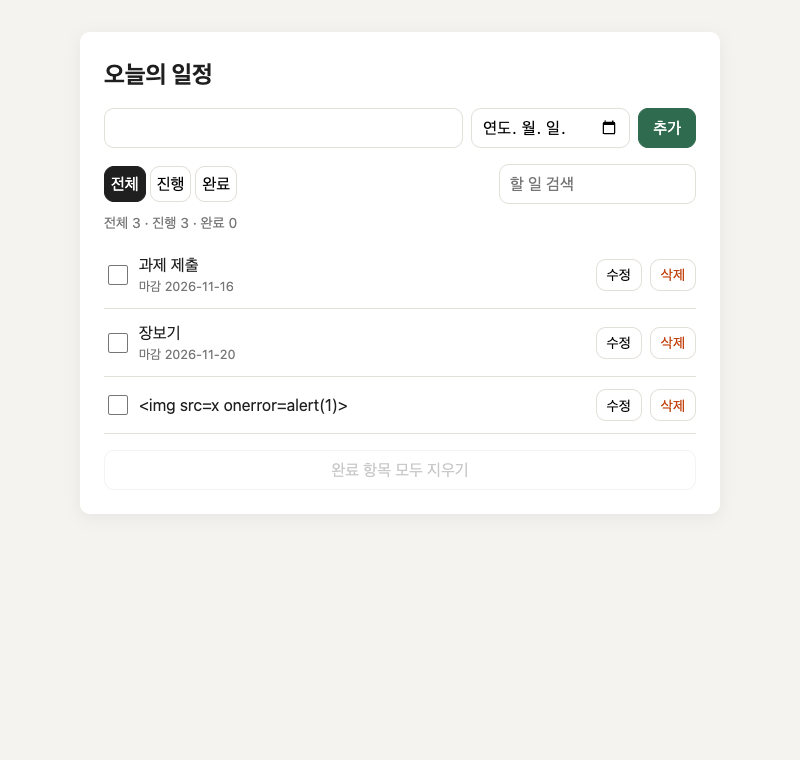
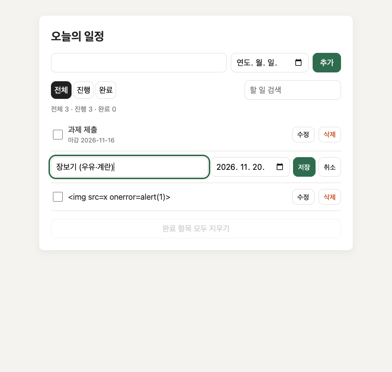
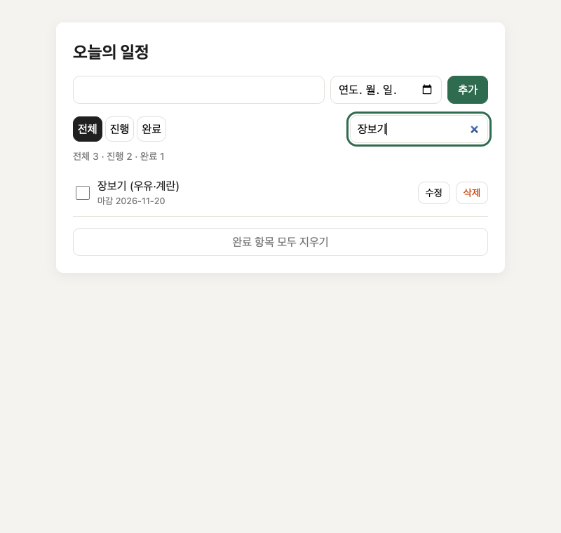
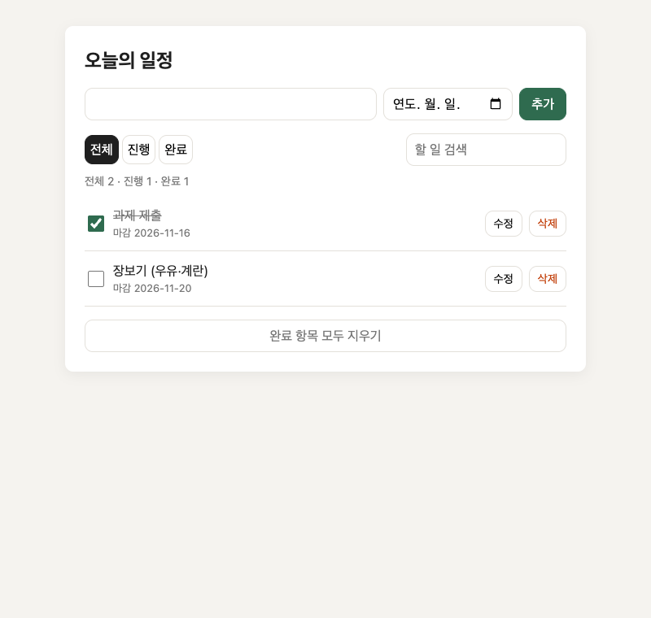

# Todo List — JavaScript DOM·이벤트

KANT CH2 프론트엔드 개발 평가 과제 ② — index.html · css/style.css · js/todo.js

## 실행
`index.html` 을 브라우저로 연다. 데이터는 브라우저 localStorage 에 저장된다.

## 시연 영상
추가(마감일순 정렬 · 빈 값 거부) → 수정(저장 · 취소) → 완료 토글 → 조회(진행·완료·전체 필터, 검색, 결과 없음) → 삭제(확인 창) · 완료 항목 일괄 삭제 → 새로고침 후 유지(localStorage)

https://github.com/user-attachments/assets/5b928932-073a-4313-b6fd-1ca63e613d9d

### 단계별 화면 (자동 브라우저 테스트 캡처)
| 추가 | 수정 | 조회 (필터·검색) | 삭제 후 |
|---|---|---|---|
|  |  |  |  |

## 기능
| 기능 | 동작 |
|---|---|
| 추가 | 할 일 + 마감일(선택) 입력 후 Enter / 추가 |
| 조회 | 전체·진행·완료 필터, 검색어 실시간 필터, 마감일 순 정렬, 전체/진행/완료 개수 |
| 수정 | 수정 버튼 또는 텍스트 더블클릭 → 저장(Enter) / 취소(Esc) · 체크박스로 완료 토글 |
| 삭제 | 개별 삭제(확인창), 완료 항목 일괄 삭제 |

## 구현 포인트
- **상태 하나 → render 하나**: `state` 객체가 유일한 진실, 모든 변경은 `commit()` / `setView()` → `render()`
- **고차 함수**: `map`(수정) · `filter`(삭제·필터·검색) · `reduce`(개수 집계) · 함수를 값으로 담은 `FILTERS`
- **불변 업데이트**: 데이터 함수는 원본을 바꾸지 않고 새 배열을 반환
- **이벤트 위임**: `ul` 한 곳에서 click·submit·dblclick·keydown 처리 (`closest('[data-action]')`)
- **성능**: `replaceChildren(...items)` 로 목록을 한 번에 교체
- **보안**: 사용자 입력은 `textContent` 로만 삽입 (XSS 방지)
